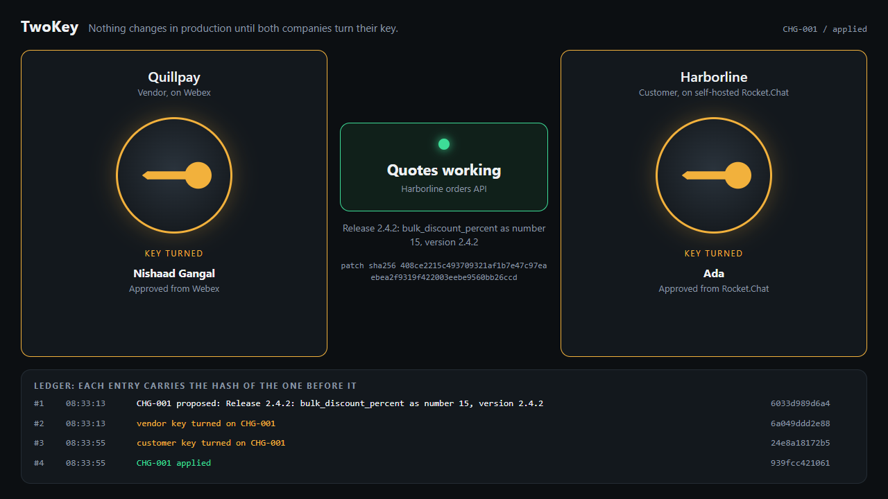
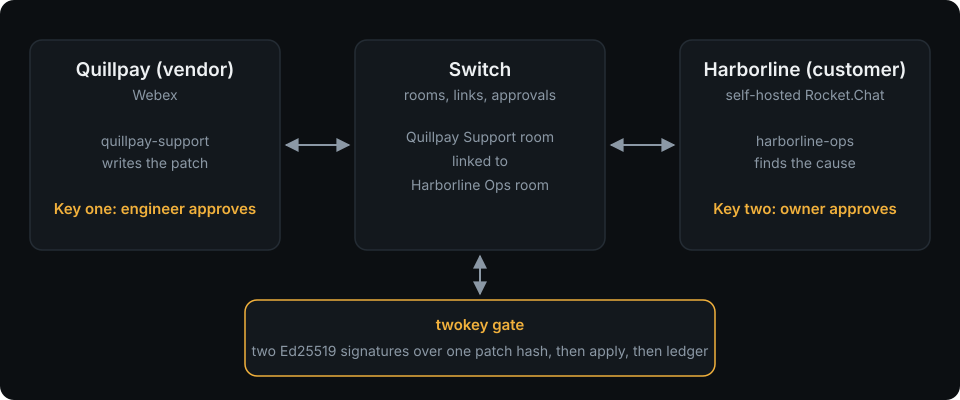

# TwoKey

**Two companies. Two chat apps. Two AI agents. Nothing reaches production until both turn their key.**



**Demo video:** VIDEO_LINK

**Try the gate in a minute, with no chat apps and no accounts:**

```bash
git clone https://github.com/NishaadG/twokey && cd twokey && ./scripts/try.sh
```

You play both companies, watch the live board at http://127.0.0.1:8787, and see the gate refuse a tampered patch and catch a rewritten ledger. It needs only `python3`, OpenSSH, `patch` and `curl`. On Windows, run it in WSL.

## The moment

A vendor's bad release has taken down a customer's orders API. The fix is one line, but the two companies don't share a chat tool. The customer runs self-hosted Rocket.Chat and won't open it to outsiders. The vendor lives in Webex. So the fix crawls through a ticket portal and email, and when it finally lands, nobody can say exactly who approved exactly what.

TwoKey puts each company's agent in its own company's chat, and lets those agents work the problem together through [Switch](https://github.com/sandbox-quantum/switch). People stay where they already work and do one thing: turn their key.

## What happens

1. Someone at Harborline, the customer, tells their agent in Rocket.Chat that quotes are failing.
2. `harborline-ops` reads the logs, finds the cause, and sees the bad file comes from the vendor.
3. It follows a Switch room link into the vendor's room and briefs `quillpay-support`, then comes back.
4. `quillpay-support` checks its release notes and writes the smallest patch.
5. **Key one:** an approval card appears in **Webex**, showing the exact patch. A Quillpay engineer presses Allow once. The patch is signed.
6. The vendor's agent crosses back and tells Harborline's agent the change is signed.
7. **Key two:** an approval card appears in **Rocket.Chat**. A Harborline person presses Allow once.
8. Both signatures verify, the patch applies, quotes recover, and the agent posts the incident record.



## Why it needs Switch

Take Switch away and the workflow stops. Switch is what provides:

- **One conversation across two platforms.** Rocket.Chat and Webex can't talk to each other. Two Switch rooms, joined by room links, can.
- **An agent per company.** Each agent answers to its own team, in its own room, on its own chat app.
- **Agent-to-agent handover.** `send_targeted_message` wakes the other company's agent in its own room.
- **The approval itself.** The card, the button, and the record of who pressed it, from which platform. The board reads that record from Switch, so an agent can't claim a person approved something.

## What the gate guarantees

An approval on its own is only a button. `twokey` makes it binding:

- Each key is a real **Ed25519 signature** over the patch's SHA-256, made and checked by OpenSSH. There's nothing to install.
- **One key changes nothing.** The patch applies only when both signatures verify.
- **The patch can't change after signing.** An edited patch no longer matches, and it's refused.
- **One company can't turn both keys.** One party's signature doesn't verify as the other's.
- **The ledger shows tampering.** Each entry carries the hash of the one before it, and `twokey audit` checks the chain.

All of this has tests: `python3 -m unittest discover tests` (8 tests, Linux).

## Run it

You need [Switch](https://github.com/sandbox-quantum/switch) with Rocket.Chat and Webex support, a Linux machine for the agents, and a free Webex bot. Rocket.Chat and Webex support are in open pull requests, so until they merge use the branch [`demo/both-platforms`](https://github.com/NishaadG/switch/tree/demo/both-platforms) of my fork.

1. Start Switch, and connect Rocket.Chat and Webex in Switch Console. Webex needs a public address for its webhooks, for example a Cloudflare tunnel.
2. Make a channel in Rocket.Chat and a space in Webex, and add the bot to each. Link your account on each side.
3. In Switch Console, add two agents, `harborline-ops` and `quillpay-support`. Paste in `agents/harborline-ops.md` and `agents/quillpay-support.md` as their instructions. Set their working directories to `~/workspace/twokey-lab/harborline` and `~/workspace/twokey-lab/quillpay`, and turn Auto mode **off**, so commands that change things ask a person.
4. Add both agents to both rooms. Link the rooms to each other, labelling the Webex room `vendor` and the Rocket.Chat room `customer`.
5. Start the lab, which runs the orders API with the bad release: `./scripts/lab.sh`
6. Start the board, then open http://127.0.0.1:8787:

   ```bash
   TWOKEY_HOME=~/workspace/twokey-lab/harborline/twokey \
   TWOKEY_APPROVALS_CMD="bash scripts/approvals.sh" python3 dashboard/server.py
   ```

7. In Rocket.Chat: `@harborline-ops customers can't get quotes from the orders API. Please diagnose it and bring in the vendor.`

Run `./scripts/lab.sh` again to reset.

## Honest limits

- Harborline and Quillpay are fictional, and the orders API is a small demo service. The people, chat apps, agents, approvals and signatures are real.
- Both private keys sit on one machine in this demo. In real use each company would hold its own, on its own host.
- Approval rests on the agent host asking a person before it runs a command, which is why Auto mode has to be off. A determined operator of that host could get around it. The signatures protect the patch, not the host.
- The full flow has been run live with both real chat apps, but only a few times.

## How it's built

| Path | What it is |
| --- | --- |
| `twokey/twokey.py` | The gate: changes, signatures, ledger |
| `agents/` | Each agent's instructions |
| `service/` | Harborline's orders API, with the bad release |
| `dashboard/` | The live board |
| `scripts/lab.sh` | Sets up and resets the lab |
| `tests/` | The gate's tests |

## License

MIT
